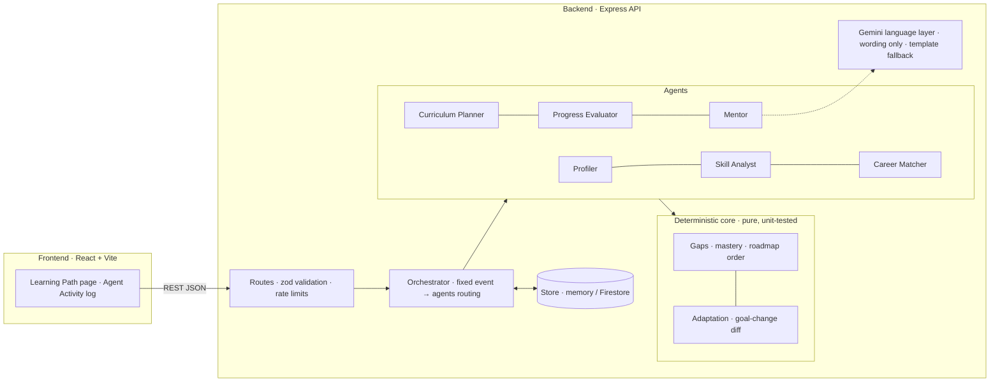

<p align="center">
  
</p>

<h1 align="center">UNBLUFF</h1>

<p align="center">
  <b>UNBLUFF verifies what a learner can actually do, finds the skills they are missing, and builds a personalized learning path that adapts as they progress, run by six collaborating AI agents.</b>
</p>

<p align="center">
  <a href="https://unbluff-skillforge.vercel.app/">Live demo</a> ·
  <a href="CONTRACT.md">API contract</a> ·
  <a href="DECISIONS.md">Design decisions</a>
</p>


## Quick start (no API key needed)

```bash
# Backend: deterministic mock AI, in-memory store, mock sign-in (development only)
cd backend && npm ci && LLM_MODE=mock STORE=memory AUTH_MODE=mock PORT=8090 CORS_ORIGIN=http://localhost:5173 npm run dev

# Frontend (second terminal)
cd frontend && npm ci && cp .env.example .env && npm run dev
# open http://localhost:5173/learning-path and click "Load sample student"

# Run every check (lint, typecheck, tests, build) for both packages
npm run verify
```

## The problem

Organizations and universities find it hard to see which skills their employees or students lack and what they need to learn to reach their career goals. Learning platforms give everyone the same courses, ignoring what a person already knows, how they are progressing, or where they want to go. Skills listed on a profile are also never verified, so nobody knows which ones are real.

## A scenario

> *An illustrative persona.* **Arun** is a student who knows Python, SQL and a little HTML. He wants to become a **Full Stack Developer**.

**Without UNBLUFF**
- A generic platform hands him the same course list as everyone else, including Python, which he already knows.
- Nobody checks whether "I know SQL" is true.
- He fails a JavaScript quiz and is handed the next course anyway.
- If he switches his goal to Data Analyst, he starts over with no credit for what he has already shown.

## How UNBLUFF solves it

The same scenario, with UNBLUFF. Every decision below is made by tested, deterministic code. The AI only writes the wording.

| Step | What happens | Agent |
|---|---|---|
| **1. Profile** | Arun enters his skills. Each one is stored as *declared, unverified* and counts for at most **40%** until he proves it. | Profiler |
| **2. Skill analysis and career match** | His skills are compared with the weighted Full Stack Developer role. The gaps are **JavaScript, React and Node.js**. The match is **9%**, low on purpose, because unverified claims are capped. | Skill Analyst, Career Matcher |
| **3. Learning recommendations** | A prerequisite-ordered roadmap of **9 steps**, each with curated resources (course, tutorial, exercise). Python and SQL are not re-taught. | Curriculum Planner |
| **4. A poor assessment** | He scores **40%** on JavaScript (labelled *Simulation* in the demo). UNBLUFF inserts a remedial step, **"Revisit: Closures & event loop"**, pauses React and Node.js until it is done, and explains why in plain language. | Progress Evaluator, Mentor |
| **5. Recovery** | A strong score (**90%**) on the remedial step unblocks the paused steps and progress rises (0% → 10%). | Progress Evaluator |
| **6. A new goal** | He switches to **Data Analyst**. The path is rebuilt, keeping what he has verified, with a diff: **2 kept, 4 added, 8 removed, 0 reordered**, each with a reason. | Curriculum Planner, Career Matcher |

An **Agent Activity** log on the page shows every action and every handoff between agents, and marks whether each decision was deterministic or written by the AI.

| Problem | How UNBLUFF solves it |
|---|---|
| Everyone gets the same courses | The roadmap is built only from the learner's real gaps, in prerequisite order |
| Profile skills are never verified | Claims are capped at 40% until verified by evidence-based interrogation |
| Poor performance changes nothing | A failed assessment inserts a remedial step and pauses dependent steps |
| Changing goal means starting over | The path is rebuilt from the new role, keeping verified skills, with a visible diff |

## What is in UNBLUFF

**Learning Path engine** (the core of this submission)
- Profile → skill analysis → career match → roadmap → progress → mentor, on one page: `/learning-path`.
- Six agents: **Profiler, Skill Analyst, Career Matcher, Curriculum Planner, Progress Evaluator, Mentor**.
- Seven weighted job roles, a prerequisite graph of learner-level topics, and **77 curated resources** (all links checked).
- Certifications map to *declared* skills through 16 curated rules; they never count as verified.

**Evidence-based skill verification**
- Each resume claim is probed at three levels: what you built, how it works, and why or when not to use it.
- The AI returns booleans plus quotes. A criterion counts only if its quote is a verbatim substring of the learner's answer, so a model that is fooled still cannot pass a criterion.
- Verdicts are Defended, Shaky, Bluff or Honest gap, with a root-cause prerequisite and a delayed retest.

**AI mentor** with persistent, learner-controlled memory.

**Other modules of the platform** (they come from the original UNBLUFF base): company-wise DSA arena, coding workspace, DSA and DBMS lessons, job matching, résumé builder with ATS score, GitHub and LeetCode insights. Modules that need external services (code execution, PDF compile, GitHub OAuth) are disabled unless configured.

## Problem statement → feature → code → test

| Requirement | Feature | Code | Test |
|---|---|---|---|
| *(keep the existing verified table from the current README here, with full repo paths and real test names)* | | | |

## Architecture



**The rule that makes it trustworthy:** gaps, ordering, mastery, adaptation and agent routing are pure TypeScript functions with tests. The AI never chooses, ranks, scores or routes. It only writes wording (mentor messages, explanations) and every call has a deterministic template fallback, so the app works fully without an API key.

- **Unverified skills** count for at most **40%** mastery.
- **Adaptation rules:** below 60% inserts a remedial step and pauses dependent steps; 60–84% completes the step with a review flag; 85% and above completes it and advances the next step.
- **Agent routing** is a constant table from event (profile submitted, assessment submitted, goal changed) to agents. Every action and handoff is logged and shown in the UI.
- **Simulation is labelled.** A client can only submit simulated scores; real results are read on the server from the learner's own graded interrogations.

Code: `backend/src/core/` (`path.ts`, `adapt.ts`, `certs.ts`), `backend/src/agents/`, `backend/data/learning/`, `frontend/src/pages/LearningPathPage.tsx`. API: `/api/learning-path` (see [CONTRACT.md](CONTRACT.md)).

## Configuration and tests

| Variable | Purpose |
|---|---|
| `LLM_MODE` | `mock` (deterministic, no key) or `live` (Gemini) |
| `STORE` | `memory` or `firestore` |
| `AUTH_MODE` | `mock` (development only, refused in production) or real Firebase Auth |
| `GEMINI_API_KEY`, `GEMINI_MODEL` | live AI mode |
| `CORS_ORIGIN` | exact frontend origin (required in production) |

See `backend/.env.example` and `frontend/.env.example`. Tests:

```bash
cd backend  && npm run lint && npm run typecheck && npm test
cd frontend && npm run lint && npm run typecheck && npm test && npm run build
npm run test:emulator   # in backend, needs Java
```


## License

See [LICENSE](LICENSE).
