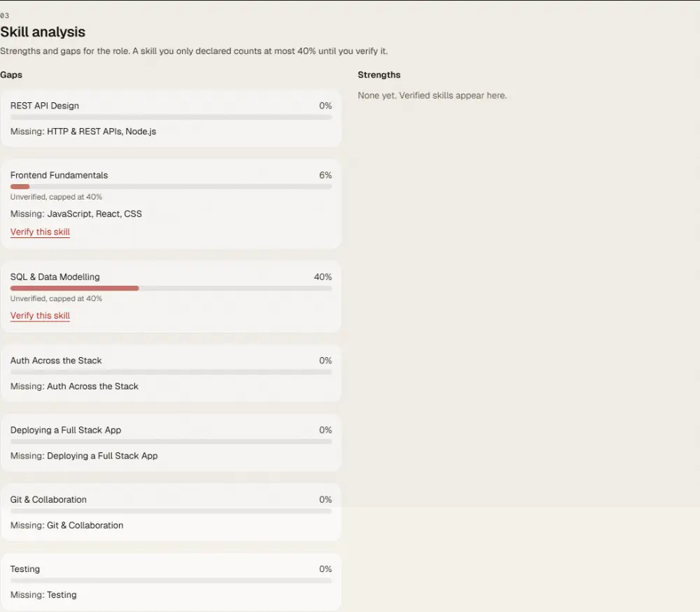
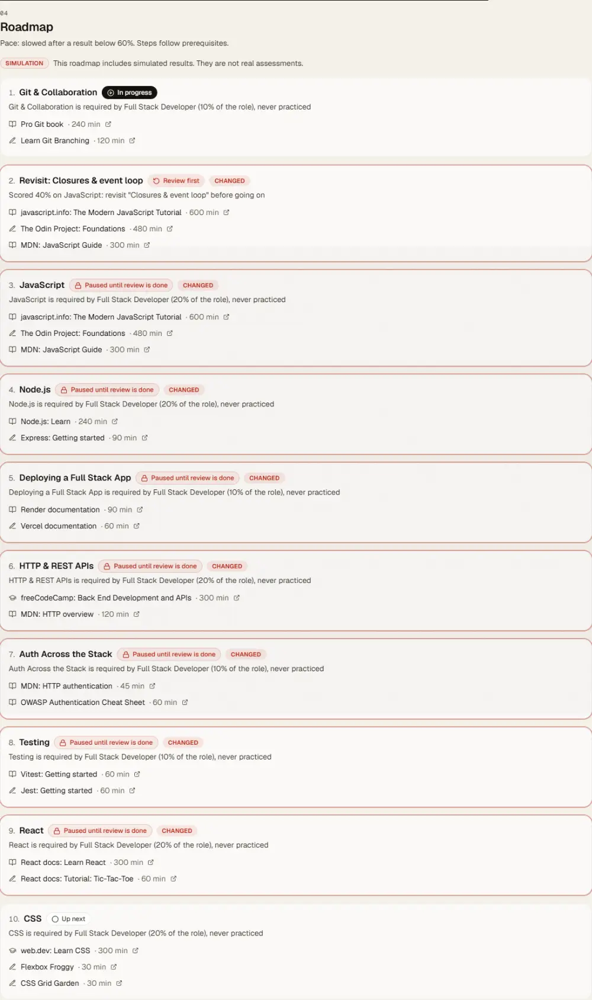
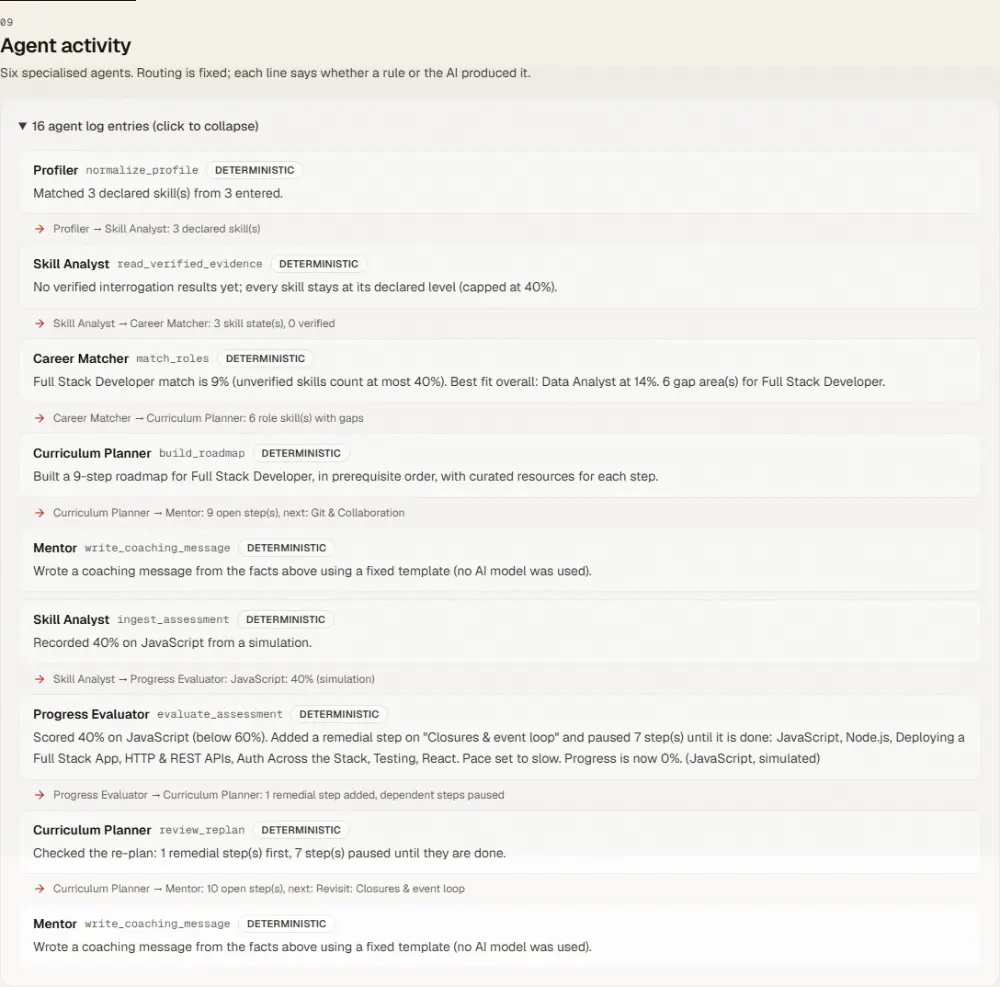
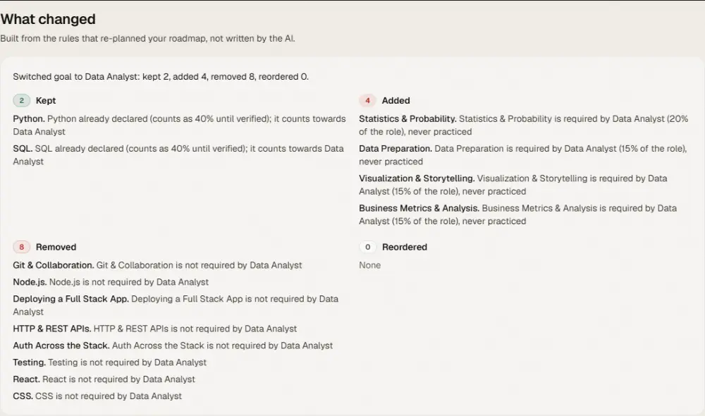
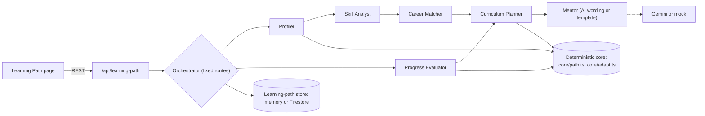

<p align="center"></p>

# UNBLUFF + SkillForge

[](https://github.com/bsrikumar855-dot/UNBLUFF-PROMPTWAR/actions/workflows/ci.yml)

**An AI-powered learning platform that measures what a learner can really do, finds the missing skills for a target career, and builds a personalised path that adapts when the goal changes or an assessment goes badly.**

Live frontend: https://unbluff-skillforge.vercel.app (static site on Vercel). The backend API is **not deployed yet**, so sign-in and every feature that calls the API are unavailable there until the Render service is up; the landing page and public pages load.

## Quick start (mock mode, no API key)

```bash
npm run setup
cd backend && LLM_MODE=mock AUTH_MODE=mock STORE=memory PORT=8090 CORS_ORIGIN=http://localhost:5173 npm run dev
cd frontend && printf 'VITE_API_URL=http://localhost:8090\nVITE_AUTH_MODE=mock\n' > .env && npm run dev
```

Open http://localhost:5173/learning-path. To check everything CI checks: `npm run verify` (backend lint, typecheck, tests with coverage, build; frontend lint, typecheck, tests, build).

## The problem and our solution

Students list skills they cannot defend, and generic course lists ignore what they already know and where they want to go. **SkillForge** reads a learner's skills, projects and certifications, scores them against a target role, and plans an ordered roadmap with free resources. Six specialised agents re-plan it when the learner fails an assessment or changes goal. It is built on **UNBLUFF**, which verifies skills by interrogating resume claims. Learners get an honest gap analysis and a plan. A university or organisation gets evidence of what a cohort can actually do, not self-reported claims.

## Problem statement → feature

| Requirement | What it does | Code | Test that proves it |
|---|---|---|---|
| User profile | Skills, projects and certifications are entered; all count as *declared* (max 40%) until verified | `backend/src/agents/profiler.ts`, `core/certs.ts` | `tests/unit/agents.test.ts` "ProfilerAgent" |
| Skill analysis | `gap = weight × (1 − mastery)` per role skill, with missing topics named | `backend/src/core/path.ts` `computeGaps` | `tests/unit/path.test.ts` "computeGaps" |
| Career matching | Match % for the target and the other 6 roles | `backend/src/agents/careerMatcher.ts` | `tests/unit/path.test.ts` "progressSummary and roleMatch" |
| Learning recommendations | Roadmap in prerequisite order, ≤3 curated free resources per step (77 entries, 59 unique URLs) | `core/path.ts` `buildPath`, `backend/data/learning/` | `tests/unit/path.test.ts` "buildPath" |
| Progress tracking | Roadmap % weighted by gap, mastery bars, next step | `core/path.ts` `progressSummary` | `tests/unit/path.test.ts` "progressSummary and roleMatch" |
| AI mentor | Writes a coaching note from facts only; template fallback | `backend/src/agents/mentorAgent.ts` | `tests/integration/learningPath.test.ts` "the mentor message" |
| Agentic AI | 6 agents, fixed routing table, visible log with handoffs | `backend/src/agents/orchestrator.ts` | `tests/unit/agents.test.ts` "routing table" |
| Adapts on goal change | Rebuild; diff of kept / added / removed / reordered with reasons | `core/adapt.ts` `adaptOnGoalChange` | `tests/unit/adapt.test.ts` "adaptOnGoalChange" |
| Adapts on poor assessment | <60: remedial step, dependents paused; 60–84 review; ≥85 done | `core/adapt.ts` `adaptOnAssessment` | `tests/unit/adapt.test.ts` "adaptOnAssessment: failing score" |
| Sample scenario | Python/SQL/HTML → Full Stack, end to end over HTTP and in the UI | — | `tests/integration/learningPath.test.ts` "the problem-statement scenario end to end"; `frontend/scripts/learning-path-demo.mjs` |

## The sample scenario, step by step

1. On `/learning-path` press **Load sample student** (Python, SQL, HTML → Full Stack Developer), then **Build my learning path**. Gaps name **JavaScript, React, Node.js**; match is 9%.
   
2. In **Assessment**, choose JavaScript, leave 40 and **Apply simulated score** (labelled *Simulation*). A remedial step "Revisit: Closures & event loop" appears and 7 dependent steps pause.
   
   
3. Apply 90: everything unblocks, progress 0% → 10%.
4. **Change career goal** → Data Analyst: kept 2 (Python, SQL), added 4, removed 8, each with a reason.
   
5. Reload: the state is still there.

Run it yourself: `cd frontend && npm i --no-save playwright-core && node scripts/learning-path-demo.mjs` (all 5 steps PASS on 14 Nov 2026).

## Architecture



| Agent | Responsibility | Decides by |
|---|---|---|
| Profiler | Resolves free-text skills, project skills, certifications to topics | rules |
| Skill Analyst | Credits verified interrogation results; records assessment results | rules |
| Career Matcher | Role match % and gaps | rules |
| Curriculum Planner | Builds / rebuilds the roadmap with resources | rules |
| Progress Evaluator | Applies a result to the roadmap | rules |
| Mentor | Words a coaching note from a facts object | **AI (language only)**, template fallback |

| Event | Agents, in order |
|---|---|
| PROFILE_SUBMITTED | Profiler → Skill Analyst → Career Matcher → Curriculum Planner → Mentor |
| ASSESSMENT_SUBMITTED | Skill Analyst → Progress Evaluator → (Curriculum Planner, only if a remedial step was added) → Mentor |
| GOAL_CHANGED | Profiler → Career Matcher → Curriculum Planner → Mentor |

**The LLM never decides.** Gaps, ordering, mastery, adaptation and routing are pure TypeScript. Thresholds: declared skills capped at 0.4, gap threshold 0.1 (inclusive), adaptation bands 60/85 (see [DECISIONS.md](DECISIONS.md)).

## How we meet the evaluation criteria

All figures from commands run on 14 Nov 2026.

| Criterion | Evidence |
|---|---|
| Code quality | `npm run verify` exits 0; ESLint `--max-warnings 0` passes in both packages; no TODO/FIXME/console.log in SkillForge files (`git grep`); thresholds documented in code and [DECISIONS.md](DECISIONS.md) |
| Security | `npm audit --omit=dev`: 0 vulnerabilities in backend and frontend; 114 routes, private by default (17 public, audited by `tests/integration/routeAudit.test.ts`); log redaction tested; demo auth and the unlicensed dataset refused in production. See [SECURITY.md](SECURITY.md) |
| Efficiency | 0 model calls for any SkillForge decision and ≤1 (mentor) per event, enforced by `tests/integration/learningPathBudget.test.ts`; `/learning-path` is a lazy chunk of 23.3 kB (6.9 kB gzip) |
| Testing | Backend 1,309 tests (87 files), frontend 407 (31 files), Firestore emulator 58 (13 files); `src/core` and `src/agents` 100% line coverage |
| Accessibility | axe-core (WCAG 2.0/2.1 A, AA): 0 serious/critical on landing, demo report, login and 3 Learning Path states; axe tests in `frontend/tests/learningPath.test.tsx`; the skip link is the first Tab stop (`frontend/tests/skipLink.test.tsx`); reduced motion skips the intro |
| PS alignment | Table above; scenario test and UI script both pass |

## Tech stack and layout

Node 20, TypeScript, Express 5, zod, Gemini (`@google/genai`), Firestore; React 18, Vite, Tailwind; Vitest, Supertest, Testing Library, axe-core.

```
backend/   src/{core,agents,learning,routes,...}  data/{roles,learning,dsa}  tests/{unit,integration,emulator}
frontend/  src/{pages,components,api,...}  tests/  scripts/
docs/      img/, security-and-launch.md, UNBLUFF-base.md
```

API: see [CONTRACT.md](CONTRACT.md) ("SkillForge learning path" section). Config: `LLM_MODE` (`mock`|`live` + `GEMINI_API_KEY`), `AUTH_MODE` (`firebase`|`mock`, mock refused in production), `STORE` (`memory`|`firestore`); full list in `backend/.env.example`. Tests: `npm run verify`; emulator suite: `npm run test:emulator` (needs Java).

## Deployment

**Architecture:** a static frontend on **Vercel** (`frontend/vercel.json`: SPA rewrite so every app route serves `index.html`, long-cache headers for `/assets/*`), a Node API on **Render** (`render.yaml`, free web service, `rootDir: backend`), and **Firebase Auth** for sign-in (ID tokens verified server-side; Firestore is optional durable storage). The frontend talks to the API over HTTPS only; CORS on the API is locked to the exact deployed frontend origin.

**Required environment variables** (names only — values are entered in each platform's dashboard, never committed):

| Where | Variable |
|---|---|
| Vercel (build-time) | `VITE_API_URL`, `VITE_FIREBASE_API_KEY`, `VITE_FIREBASE_AUTH_DOMAIN`, `VITE_FIREBASE_PROJECT_ID`, `VITE_FIREBASE_APP_ID`, `VITE_CONTACT_EMAIL` |
| Render (runtime) | `GEMINI_API_KEY`, `FIREBASE_PROJECT_ID`, `CORS_ORIGIN`, `STORE` (`firestore` for durable sessions), `FIREBASE_SERVICE_ACCOUNT_JSON` (if using `STORE=firestore` off Google Cloud), `GITHUB_CLIENT_ID`/`GITHUB_CLIENT_SECRET`/`GITHUB_REDIRECT_URI`/`GITHUB_TOKEN_ENCRYPTION_KEY` (optional, GitHub insights) |

Full list with descriptions: `backend/.env.example` and `render.yaml`.

**Caveats, stated plainly:**
- `STORE=memory` (the default outside Firestore) resets every student session on restart or redeploy, and is refused in production unless `ALLOW_EPHEMERAL_STORE=true` is also set — use `STORE=firestore` for anything real.
- Render's free plan spins the service down after inactivity; the first request after idle can take 30–60+ seconds (cold start) before `/api/health` answers.
- `LLM_MODE=mock` is refused in production unless `ALLOW_MOCK_LLM=true` is explicitly set (a deployment must not present canned answers as a real AI mentor).

## Known limits

- Simulated scores are labelled *Simulation*; unverified skills are capped at 40%.
- Certification mapping covers 16 curated rules; generic cloud certifications are deliberately unmapped.
- Code execution needs Judge0 or Docker, the résumé PDF build needs Docker, GitHub insights need an OAuth app; none is enabled by default.
- The Firestore learning-path store is emulator-tested only, not verified in a live deployment.
